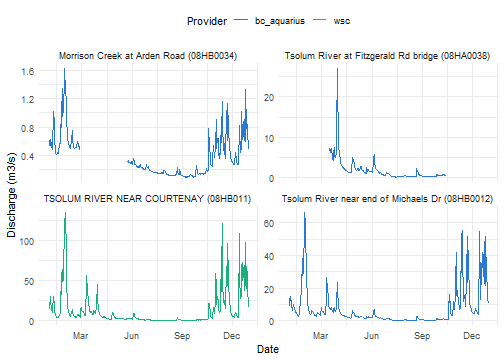

<!--
This vignette is precomputed because it queries live web services. Edit
vignettes/combining-sources.Rmd.orig, not combining-sources.Rmd, then rebuild
from the package root with source("vignettes/precompile.R").
-->


## Overview

`hydrocan` is a set of R functions for reading streamflow and water level data
from Canadian data providers. Each provider publishes its data in its own
format, with its own time zones and quality codes. `hydrocan` returns data from
every provider with the same columns, so results from different providers can
be combined directly.

`hydrocan` covers provincial, utility and research monitoring networks. It does
not cover the federal Water Survey of Canada (WSC) network, which is available
through [`tidyhydat`](https://docs.ropensci.org/tidyhydat/).

This vignette shows a common workflow: building a single table of all
available flow data for a study area, using `hydrocan` and `tidyhydat`
together. The example study area is the Tsolum River near Courtenay, BC. The
vignette covers:

1. listing and citing data sources
2. finding stations in a study area
3. reading flow data
4. adding WSC data from `tidyhydat`
5. checking and plotting the combined data

This vignette is a high-level guide. Each function's arguments and outputs are
documented in detail in its help page; see `help(package = "hydrocan")`.

## Installation

Install `hydrocan` from CRAN, or the development version from the Hakai
Institute r-universe:


``` r
install.packages("hydrocan")

install.packages("hydrocan", repos = "https://hakaiinstitute.r-universe.dev")
```

This vignette also uses `dplyr`, `ggplot2` and `tidyhydat`:


``` r
library(hydrocan)
library(dplyr)
library(ggplot2)
```

### Downloading HYDAT

`tidyhydat` reads WSC data from a local copy of the
[HYDAT database](https://www.canada.ca/en/environment-climate-change/services/water-overview/quantity/monitoring/survey/data-products-services/national-archive-hydat.html).
Download it once with the following function. `tidyhydat` saves the database
and finds it again in later R sessions. HYDAT is large, so the download takes
several minutes:


``` r
tidyhydat::download_hydat()
```

HYDAT is updated several times a year. To check which version you have:


``` r
tidyhydat::hy_version()
```

`hydrocan` itself doesn't need HYDAT; only the WSC section of this vignette
does.

## Data sources

`hc_list_sources()` lists the available data sources and the types of data
each one publishes:


``` r
hc_list_sources() |>
  select(name, has_flows, has_daily_flows, has_levels, has_daily_levels, license)
#> # A tibble: 4 × 6
#>   name         has_flows has_daily_flows has_levels has_daily_levels license    
#>   <chr>        <lgl>     <lgl>           <lgl>      <lgl>            <chr>      
#> 1 hydroquebec  TRUE      TRUE            FALSE      FALSE            CC BY-NC 4…
#> 2 bc_aquarius  TRUE      TRUE            TRUE       TRUE             CC BY 4.0  
#> 3 cehq         FALSE     TRUE            FALSE      TRUE             CC BY 4.0  
#> 4 hakai_erddap TRUE      FALSE           TRUE       FALSE            CC BY 4.0
```

The `has_*` columns show which reading functions return data for a source:
`hc_read_flows()` and `hc_read_daily_flows()` for flow, and
`hc_read_levels()` and `hc_read_daily_levels()` for water level. The
`description` column (not shown here) has a short summary of each source.

Each provider publishes its data under its own licence. Check the `license`
and `terms_url` columns before reusing data, and use `hc_citation()` to cite a
source:


``` r
hc_citation("bc_aquarius")
#> To cite 'bc_aquarius' data in publications use:
#> 
#>   Government of British Columbia (2026). "Hydrometric Stations."
#>   Accessed via the hydrocan R package License: CC BY 4.0,
#>   <https://bcmoe-prod.aquaticinformatics.net/Data/GetFile/GettingStartedGuide>.
#> 
#> A BibTeX entry for LaTeX users is
#> 
#>   @Misc{,
#>     title = {Hydrometric Stations},
#>     year = {2026},
#>     note = {Accessed via the hydrocan R package License: CC BY 4.0},
#>     author = {{Government of British Columbia}},
#>     url = {https://bcmoe-prod.aquaticinformatics.net/Data/GetFile/GettingStartedGuide},
#>   }
```

## Finding stations

`hc_read_stations()` returns metadata for every station from every source,
or from one source if you set `source`. To find stations by name or location,
filter the result with `dplyr`.


``` r
stations <- hc_read_stations()
```

### By name

If you know the river, search the station names. `grepl()` with
`ignore.case = TRUE` matches part of a name in any case:


``` r
stations |>
  filter(grepl("tsolum", station_name, ignore.case = TRUE)) |>
  select(station_id, station_name, provider_name)
#> # A tibble: 3 × 3
#>   station_id station_name                                provider_name
#>   <chr>      <chr>                                       <chr>        
#> 1 08HA0038   Tsolum River at Fitzgerald Rd bridge        bc_aquarius  
#> 2 08HB0012   Tsolum River near end of Michaels Dr        bc_aquarius  
#> 3 08HB0037   Headquarters Creek Upstream of Tsolum River bc_aquarius
```

A name search misses tributaries whose names don't mention the river, such as
Morrison and Portuguese creeks.

### By area

To find every station in a study area, filter on `latitude` and `longitude`.
This works the same way for every provider:


``` r
tsolum_area <- stations |>
  filter(
    between(latitude, 49.65, 49.85),
    between(longitude, -125.15, -124.95)
  )

tsolum_area |>
  select(station_id, station_name, provider_name)
#> # A tibble: 6 × 3
#>   station_id station_name                                provider_name
#>   <chr>      <chr>                                       <chr>        
#> 1 08HA0038   Tsolum River at Fitzgerald Rd bridge        bc_aquarius  
#> 2 08HB0012   Tsolum River near end of Michaels Dr        bc_aquarius  
#> 3 08HB0018   Morrison Creek near the Mouth               bc_aquarius  
#> 4 08HB0030   Portuguese Creek at Headquarters Rd         bc_aquarius  
#> 5 08HB0034   Morrison Creek at Arden Road                bc_aquarius  
#> 6 08HB0037   Headquarters Creek Upstream of Tsolum River bc_aquarius
```

This also finds the stations on Morrison and Portuguese creeks.

### By period of record

`period_start` and `period_end` give the period each station has data for.
To keep stations whose record covers all of 2024:


``` r
tsolum_area |>
  filter(
    period_start <= as.Date("2024-01-01"),
    is.na(period_end) | period_end >= as.Date("2024-12-31")
  ) |>
  select(station_id, station_name, period_start, period_end)
#> # A tibble: 3 × 4
#>   station_id station_name                         period_start period_end
#>   <chr>      <chr>                                <date>       <date>    
#> 1 08HA0038   Tsolum River at Fitzgerald Rd bridge 2022-07-13   2026-06-04
#> 2 08HB0012   Tsolum River near end of Michaels Dr 2012-09-13   2026-05-15
#> 3 08HB0034   Morrison Creek at Arden Road         2023-09-20   2026-04-09
```

`is.na(period_end)` keeps stations with no end date, which some providers use
for stations that are still running. These dates come from each provider's
metadata and describe the whole record, not every day in it, so check what a
query actually returns.

### Choosing stations

Combining the area and period filters gives the three BC Government
hydrometric stations used in the rest of this vignette, two on the Tsolum
River and one on Morrison Creek:


``` r
tsolum_ids <- tsolum_area |>
  filter(
    period_start <= as.Date("2024-01-01"),
    is.na(period_end) | period_end >= as.Date("2024-12-31")
  ) |>
  pull(station_id)

tsolum_ids
#> [1] "08HA0038" "08HB0012" "08HB0034"
```

## Reading flow data

`hc_read_daily_flows()` reads daily flow for one or more stations. It takes
the following arguments:

- `station_id`: a character vector of station IDs, as returned by
  `hc_read_stations()`.
- `start_date` and `end_date`: the period to read, as Dates or as character
  strings in `"YYYY-MM-DD"` format. `end_date` defaults to today.
- `source`: optional. `hydrocan` works out which source each station ID
  belongs to, so stations from different providers can be read in one call.
  Set `source` to skip this lookup when you already know the provider.


``` r
bc_daily <- hc_read_daily_flows(
  station_id = tsolum_ids,
  start_date = "2024-01-01",
  end_date = "2024-12-31"
)

bc_daily
#> ── hydrocan ────────────────────────────────────────────────────────────────────
#>   Observations: 1,098
#>   Source: bc_aquarius
#>   Parameter: water_discharge
#>   Date range: 2024-01-01 to 2024-12-31
#>   Stations: 3 returned
#> ✔ All stations returned.
#> ────────────────────────────────────────────────────────────────────────────────
#> # A tibble: 1,098 × 8
#>    station_id date       value parameter       unit  provider_name quality_code
#>  * <chr>      <date>     <dbl> <chr>           <chr> <chr>         <chr>       
#>  1 08HA0038   2024-01-01   NaN water_discharge m3/s  bc_aquarius   <NA>        
#>  2 08HA0038   2024-01-02   NaN water_discharge m3/s  bc_aquarius   <NA>        
#>  3 08HA0038   2024-01-03   NaN water_discharge m3/s  bc_aquarius   <NA>        
#>  4 08HA0038   2024-01-04   NaN water_discharge m3/s  bc_aquarius   <NA>        
#>  5 08HA0038   2024-01-05   NaN water_discharge m3/s  bc_aquarius   <NA>        
#>  6 08HA0038   2024-01-06   NaN water_discharge m3/s  bc_aquarius   <NA>        
#>  7 08HA0038   2024-01-07   NaN water_discharge m3/s  bc_aquarius   <NA>        
#>  8 08HA0038   2024-01-08   NaN water_discharge m3/s  bc_aquarius   <NA>        
#>  9 08HA0038   2024-01-09   NaN water_discharge m3/s  bc_aquarius   <NA>        
#> 10 08HA0038   2024-01-10   NaN water_discharge m3/s  bc_aquarius   <NA>        
#> # ℹ 1,088 more rows
#> # ℹ 1 more variable: qf_desc <chr>
```

The header summarises what was returned, including any requested stations
with no data. Below it is a tibble with the same columns for every provider:

- `station_id`: the provider's station identifier.
- `date`: the day (class Date). Sub-daily functions return a `timestamp`
  column instead, always in UTC.
- `value`: the measurement.
- `parameter`: what was measured, e.g. `"water_discharge"` for flow.
- `unit`: standardised across providers, `"m3/s"` for flow and `"m"` for
  water level.
- `provider_name`: the source the row came from.
- `quality_code`: the provider's raw quality or status code.
- `qf_desc`: a description of `quality_code`, where the provider documents
  one.

`hc_read_flows()` reads sub-daily data at each station's native logging
interval. For the `bc_aquarius` source, the `quality_code` column of sub-daily
data is the approval level of each value:


``` r
bc_subdaily <- hc_read_flows(
  station_id = tsolum_ids,
  start_date = "2024-01-01",
  end_date = "2024-12-31"
) |>
  tibble::as_tibble()

bc_subdaily |>
  count(station_id, quality_code, qf_desc)
#> # A tibble: 3 × 4
#>   station_id quality_code qf_desc       n
#>   <chr>      <chr>        <chr>     <int>
#> 1 08HA0038   950          REVIEWED  86146
#> 2 08HB0012   900          IN REVIEW 22681
#> 3 08HB0034   1200         APPROVED  26963
```

The approval levels are WORKING (800), IN REVIEW (900), REVIEWED (950) and
APPROVED (1200). Recent data is usually WORKING and can change after you
download it. Daily values from `bc_aquarius` have no quality codes.

## Adding WSC data

`tidyhydat` reads WSC data from your local copy of HYDAT (see
[Downloading HYDAT](#downloading-hydat)). It has its own station name search:


``` r
tidyhydat::search_stn_name("tsolum")
#> # A tibble: 3 × 5
#>   STATION_NUMBER STATION_NAME             PROV_TERR_STATE_LOC LATITUDE LONGITUDE
#>   <chr>          <chr>                    <chr>                  <dbl>     <dbl>
#> 1 08HB011        TSOLUM RIVER NEAR COURT… BC                      49.7     -125.
#> 2 08HB089        TSOLUM RIVER BELOW MURE… BC                      49.8     -125.
#> 3 08HB090        HEADQUARTERS CREEK ABOV… BC                      49.8     -125.
```

WSC station 08HB011, Tsolum River near Courtenay, is downstream of the BC
Government stations. `tidyhydat` uses its own column names, so rename them to
match `hydrocan`. WSC data symbols become the quality codes:


``` r
wsc_daily <- tidyhydat::hy_daily_flows(
  station_number = "08HB011",
  start_date = "2024-01-01",
  end_date = "2024-12-31"
) |>
  left_join(
    tidyhydat::hy_data_symbols |> select(SYMBOL_ID, SYMBOL_EN),
    by = join_by(Symbol == SYMBOL_ID)
  ) |>
  select(
    station_id = STATION_NUMBER,
    date = Date,
    value = Value,
    quality_code = Symbol,
    qf_desc = SYMBOL_EN
  ) |>
  mutate(
    parameter = "water_discharge",
    unit = "m3/s",
    provider_name = "wsc",
    .after = value
  )
```

## Building the combined table

With matching columns, `bind_rows()` combines the two sources. Station names
from `hc_read_stations()` and `tidyhydat::hy_stations()` are added for
labelling:


``` r
station_names <- bind_rows(
  stations |> select(station_id, station_name),
  tidyhydat::hy_stations("08HB011") |>
    select(station_id = STATION_NUMBER, station_name = STATION_NAME)
)

tsolum_flows <- bind_rows(bc_daily, wsc_daily) |>
  tibble::as_tibble() |>
  left_join(station_names, by = join_by(station_id))

tsolum_flows |>
  count(provider_name, station_id, station_name)
#> # A tibble: 4 × 4
#>   provider_name station_id station_name                             n
#>   <chr>         <chr>      <chr>                                <int>
#> 1 bc_aquarius   08HA0038   Tsolum River at Fitzgerald Rd bridge   366
#> 2 bc_aquarius   08HB0012   Tsolum River near end of Michaels Dr   366
#> 3 bc_aquarius   08HB0034   Morrison Creek at Arden Road           366
#> 4 wsc           08HB011    TSOLUM RIVER NEAR COURTENAY            366
```

## Checking the combined data

Check completeness before using the data. A gap at one station affects any
comparison that includes it:


``` r
days_in_period <- as.numeric(as.Date("2024-12-31") - as.Date("2024-01-01")) + 1

tsolum_flows |>
  summarise(
    n_days = sum(!is.na(value)),
    pct_complete = round(100 * n_days / days_in_period),
    .by = c(provider_name, station_id, station_name)
  )
#> # A tibble: 4 × 5
#>   provider_name station_id station_name                      n_days pct_complete
#>   <chr>         <chr>      <chr>                              <int>        <dbl>
#> 1 bc_aquarius   08HA0038   Tsolum River at Fitzgerald Rd br…    217           59
#> 2 bc_aquarius   08HB0012   Tsolum River near end of Michael…    365          100
#> 3 bc_aquarius   08HB0034   Morrison Creek at Arden Road         280           77
#> 4 wsc           08HB011    TSOLUM RIVER NEAR COURTENAY          366          100
```

A hydrograph of each station shows the gaps and the timing of events:


``` r
tsolum_flows |>
  mutate(label = paste0(station_name, " (", station_id, ")")) |>
  ggplot(aes(x = date, y = value, colour = provider_name)) +
  geom_line(linewidth = 0.5, na.rm = TRUE) +
  facet_wrap(vars(label), ncol = 2, scales = "free_y") +
  scale_x_date(date_breaks = "3 months", date_labels = "%b") +
  scale_colour_manual(values = c(bc_aquarius = "#2a78d6", wsc = "#1baf7a")) +
  labs(x = "Date", y = "Discharge (m3/s)", colour = "Provider") +
  theme_minimal() +
  theme(legend.position = "top")
```

<div class="figure">

<p class="caption">plot of chunk hydrographs</p>
</div>

Each panel has its own y-axis, so the plot compares timing, not size. Gaps in
the lines are missing days.

## Caveats

A shared format makes data easy to combine. It does not make data from
different providers equivalent. `hydrocan` documents how it requests and
formats data from each source, but how each provider collects, processes and
flags its data is up to the provider. It's up to the user to confirm those
details in each provider's documentation before analysing combined data. In
particular, check:

- **Resolution.** Sub-daily data comes at each station's native logging
  interval, which differs between stations and can change within a record.
  `hydrocan` doesn't resample it, so confirm the interval of the data you read
  before comparing or aggregating it. Keep sub-daily and daily data in
  separate tables.
- **Day boundaries.** Providers may define a "day" differently. Confirm how daily
  values are calculated in the provider's documentation; the `docs_url`
  column of `hc_list_sources()` links to it for each `hydrocan` source.
- **Time zones.** Sub-daily timestamps from `hydrocan` are always in UTC.
- **Provisional data.** Recent data is usually provisional and can be
  revised. How it's marked differs by provider.

## Next steps

- Reference documentation for
  [`hc_read_flows()`](https://hakaiinstitute.github.io/hydrocan/reference/hc_read_flows.html),
  [`hc_read_daily_flows()`](https://hakaiinstitute.github.io/hydrocan/reference/hc_read_daily_flows.html),
  [`hc_read_levels()`](https://hakaiinstitute.github.io/hydrocan/reference/hc_read_levels.html),
  [`hc_read_daily_levels()`](https://hakaiinstitute.github.io/hydrocan/reference/hc_read_daily_levels.html),
  [`hc_read_stations()`](https://hakaiinstitute.github.io/hydrocan/reference/hc_read_stations.html)
  and
  [`hc_list_sources()`](https://hakaiinstitute.github.io/hydrocan/reference/hc_list_sources.html).
- `vignette("hydrocan-adapters")` explains how sources are added, including
  how to write an adapter for a new one.
- [`tidyhydat`](https://docs.ropensci.org/tidyhydat/) for the federal WSC
  network.
